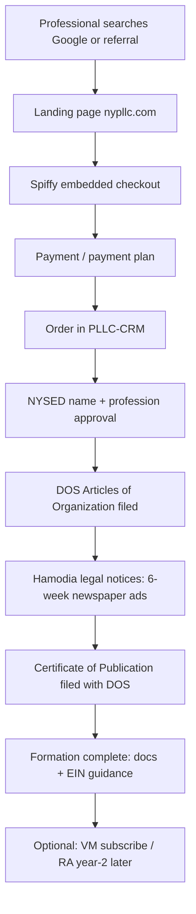
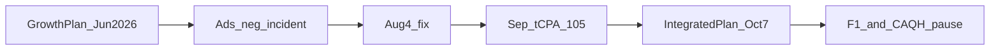

# Acceleration to ~$1M Net — Canonical Status (self-contained)

**As of:** Thursday, October 15, 2026  
**Owner:** Sid  
**Horizon:** Oct 2026 → Dec 2028 (2028 = target calendar year for ~$1M net profit)

**Reader contract:** Everything you need to understand the business, the $1M acceleration strategy, execution playbook, and current status is in **this file only**. Other repo documents may exist for staff and agents; they are not required reading. When this file disagrees with an older memo on **current status**, this file wins for status; the inlined **operating specification** below wins for targets and lever sequence unless a gate explicitly changes them.

**If you are new:** read **§1 Business primer** first, then **§2 Executive summary**, then **§4 Journey chronology** for history. Skim **§6–§11** for the financial model and growth levers; use **§15–§16** for the open task list and dated gates.

**Roles:** **Sid** (owner — decisions, partner relationships, some client sends) · **Ops** (CRM fulfillment — filings, mail, newspaper, subscriptions) · **Agent** (research, drafts, code, ads pulls — not a substitute for Sid on partner deals)

**Document map:** §0 freshness · §1 **business primer** · §2 executive · §3 strategy · §4 **journey chronology** · §5 baseline metrics · §6 2028 model · §7 formation levers F1–F8 · §8 B2B playbook · §9 VM/RA · §10 services · §11 Google Ads ops · §12 CRM capacity · §13 roadblocks · §14 closed log · §15 open tasks · §16 gates · §17 measurement · §18 resources · §19 maintenance

---

## 0. Data freshness (Oct 15, 2026)

| Data | As-of | Notes |
|------|-------|--------|
| Formation orders, abandonment, B2B partner count | **Oct 15** | CRM production query |
| Google Ads CPA, eligible, `03` | **Oct 3** | Latest daily SOP in repo; no Oct 4–15 ads pull on disk |
| VM/RA cohort tables | **Oct 7** | Integrated baseline pull + RA ops through Sep 23 T-30 |

---

## 1. Business primer (read this first if you are new)

This section explains **what the company is**, **what customers buy**, **how work gets done**, and **how we make money** — with no assumed knowledge of New York law, healthcare, or our internal tools.

### 1.1 What this company is

| Question | Answer |
|----------|--------|
| **Public brand** | **New York PLLC** — website **www.nypllc.com** |
| **What we do** | We help **licensed professionals** legally form and maintain a **New York Professional Limited Liability Company (PLLC)** — a special type of LLC only people with certain NY professional licenses may own |
| **What we are not** | We are **not** a law firm and do **not** give legal advice. We are **not** a generic “LLC in a box” shop for anyone off the street (that is a **sister company**, below) |
| **Scale (Oct 2026)** | Roughly **~50 new formation customers per month** (~600/year). Lifetime formations in CRM are in the **hundreds**, not tens of thousands |
| **Team shape** | Small operator-led business: **Sid** runs growth and hard decisions; **Ops** runs fulfillment in a custom CRM; engineers/agents build site, automations, and reporting |

**Why “professional” matters:** A dentist, therapist, physician, lawyer, CPA, architect, etc. in New York often **must** use a PLLC (or PC) — not a plain LLC — to practice in their own entity. That is our entire market focus.

### 1.2 The customer and their problem

**Typical customer:** A licensed clinician or professional in New York (or moving to NY) who wants to **open a solo or small group practice**, bill insurance or clients through their own entity, or separate liability from personal assets.

**What intimidates them:**

1. **Two different state agencies** — education/licensing (**NYSED**) must approve the entity name and profession; corporations (**NY Department of State / DOS**) files the Articles of Organization.
2. **Mandatory newspaper publication** — After DOS approval, NY law requires advertising the formation in **two newspapers for six weeks**, then filing a **Certificate of Publication**. Many competitors quote a low formation fee and charge **$500–$1,000+ extra** for publication. We **include publication in the advertised price**.
3. **Timeline uncertainty** — NYSED review can take weeks; publication adds ~6 weeks; customers want one vendor and a clear status.

**Our promise (marketing):** One **flat fee** (currently **$885**), includes formation workflow **and** publication, with status updates until the entity is fully formed and publication is filed.

### 1.3 What we sell (product catalog)

| Product | Price (typical) | One-time or recurring | What it is |
|---------|-----------------|----------------------|------------|
| **NY PLLC formation package** | **$885** flat | One-time (often **4-payment plan** at checkout) | Name clearance support, NYSED filing, DOS Articles, **full newspaper publication**, Certificate of Publication filing, document delivery |
| **Foreign qualification (into NY)** | **$895–$1,000** by home state | One-time | An entity formed in another state (e.g. Colorado) that must **register to do business in NY** — includes publication where applicable |
| **NY → other state foreign qual** | e.g. **$500** to CO | One-time | Outbound registration (smaller volume) |
| **Virtual mail (VM)** | **$50/month** | Recurring | Customer uses our **commercial address** on the public DOS record instead of home address; we scan and forward mail |
| **Registered agent (RA)** | **$0 year 1** (bundled), then **$99/year** auto-renew | Recurring from year 2 | We are the **statutory agent** for DOS legal notices; year-2+ renewals are a major 2028 profit lever |
| **Compliance Plan (upsell)** | **$249/year** | Recurring | Optional upgrade on RA renewal emails — annual compliance reminders / light support positioning |
| **S Corp election add-on** | **$195** at checkout | One-time | Help customer elect S Corp tax status with IRS (checkbox on checkout) |
| **CAQH ProView setup (paused Oct 2026)** | **$499** | One-time service | Would help healthcare providers complete **CAQH** credentialing database — **0 sales**; product paused |
| **MSO pair (unpublished)** | **$1,770** planned | One-time | Some clinicians need **two entities**: a **PLLC** (clinical) + a **management LLC** (MSO). Offer locked internally; **no public checkout yet** |
| **B2B / partner wholesale** | **$800–$885** depending on tier | Per referral order | Accountants, consultants, platforms refer clients; we share economics via coupons and **$75** advocate payout at DOS filing |

**Out of scope (sister company):** **Plain (non-professional) LLC** formation is **CheapNewYorkLLC.com**. We do not build SEO or strategy to steal plain-LLC search traffic. A small amount of Google Ads spend still hits plain-LLC queries — an unresolved overlap question with the sister account.

### 1.4 End-to-end customer journey (happy path)

**Step detail for operators:**

1. **Marketing site** (Next.js on Vercel) — profession-specific pages (dentist, therapist, lawyer, etc.), cost/FAQ content, foreign-state pages, partner landing `/formation-partners`.
2. **Checkout** — **Spiffy.co** embed (not Stripe-hosted on our domain). Customer pays **$885** or starts a **payment plan** (~42% choose plans). Optional checkboxes: S Corp, CAQH interest (no charge), VM, RA consent language.
3. **CRM (PLLC-CRM)** — Order becomes the **system of record**: owners, license numbers, addresses, pipeline stage, documents, emails, tasks. Staff use this daily; the marketing site does not fulfill orders.
4. **NYSED** — Staff prepare and file profession-specific paperwork; wait for approval or deficiency letters.
5. **DOS** — File Articles; customer’s **registered agent** and **address** appear on public records.
6. **Publication** — We place legal notices through **Hamodia** (newspaper vendor pipeline). This is **real COGS**, not a pass-through markup game — margin depends on efficient placement.
7. **Completion** — Customer receives PDFs; we may pitch VM, second entity, or (when active) services like CAQH.

**Average time:** Marketing once claimed “same day filing initiation”; **total calendar time** is often **many weeks** because of NYSED + publication — setting expectations in email and LPs is part of conversion work (**F2**).

### 1.5 How we make money (unit economics)

**Revenue** is not only the **$885** list price. Average order value in CRM is **~$908** because of add-ons (S Corp, foreign qual upsells, etc.).

**Contribution margin (formation):** After newspaper, state fees, payment processing, and allocated labor, internal planning uses **~$520 net profit per formation order** before **paid advertising**. That number is the basis for “**+10 orders/month ≈ +$62K/year**” in the growth model.

**Recurring revenue (strategic):**

- **Virtual mail:** ~**$50/mo** × subscribers. High margin **if** mail handling stays efficient (we measure true unit cost — gate **Oct 31, 2026**).
- **Registered agent:** **$99/year** from year 2 on **~370** trialing subs as of Oct 2026 — **first live charges Oct 23, 2026**. Renewal rate is **unknown** until cohorts pay; model assumes **~65%** keep paying.

**Paid acquisition:** Google Ads spend **~$2,500/month** at Oct 2026 run rate. **Target CPA (cost per acquisition)** on Google is managed with a portfolio bid strategy — currently **hold at $105** per conversion (Spiffy “Purchase” tag). If CPA or volume fails **Nov 1** review, we cap spend and lean on organic/B2B.

**Services layer** (CAQH, affiliates, shelf filings) is **optional upside** in the $1M model — **not** required to understand the core business, but CAQH was ~$35K of the 2028 spreadsheet before **Oct 14 pause**.

### 1.6 Systems and where data lives

| System | Purpose | You should know |
|--------|---------|-----------------|
| **www.nypllc.com** | Marketing, content, checkout embed, abandonment beacon | Code repo: `new-york-pllc` |
| **Spiffy** | Checkout, payment plans, some product SKUs | Customer-facing payment; we avoid naming “Spiffy” in **client** emails |
| **PLLC-CRM** | Orders, filings, mail, VM/RA subscriptions, B2B partners, ops email | Code repo: `PLLC-CRM`; **production database** is source of truth for orders |
| **Google Ads** | Paid search campaigns `01` Core, `02` Professions, `03` Foreign, plus `Sales` | Account ID **1529880213**; weekly/daily SOP discipline |
| **Microsoft Ads** | Planned duplicate channel (**F5**) | **Suspended Sep 2026** — address mismatch on verification |
| **Stripe** | Charges for VM, RA renewals, some invoices | Descriptor for RA should read **REG AGENT** |
| **Gmail** | Client and vendor email | Ops close-out tooling for inbox workflows |
| **Google Analytics 4** | Site funnel | Purchase events **not** imported into Google Ads (avoid double counting) |

**Attribution:** Roughly **~40%** of orders have a **Google click ID** (`gclid`); the rest are direct, organic, referral, B2B, or unknown. **~9 orders** have been attributed to **ChatGPT** as referrer — a small but real “AI discovery” channel.

### 1.7 Regulators and vendors (minimal glossary)

| Term | Plain meaning |
|------|----------------|
| **NYSED** | NY State Education Department — approves professional entity names and licenses for many professions |
| **DOS** | NY Department of State — corporate filings (Articles, CoP, registered agent on record) |
| **Certificate of Publication (CoP)** | Proof you finished newspaper ads; filed with DOS |
| **Registered agent (RA)** | Entity that receives **legal service of process** for the company; must stay current on DOS |
| **Foreign qualification (FQ)** | Registering an out-of-state company **to operate in NY** (or NY company in another state) |
| **CAQH / ProView** | National database insurers use for provider credentialing — mostly **healthcare** customers |
| **Hamodia** | Newspaper vendor for **legal notice** placements (affidavits, run dates) |
| **OP / “OP approved”** | Stage when NYSED has approved the entity — trigger for upsell emails (e.g. virtual mail) |
| **DOS filed** | Articles accepted — trigger for **B2B advocate payout** ($75) and many “you’re official” emails |

### 1.8 Who buys from us (mix)

Roughly **~75% healthcare** in recent months: physicians, mental health counselors (MHC), clinical social workers (LCSW), psychiatric NPs, dentists, etc. **Law** is a meaningful minority (~25 in a 6-month sample). This mix drives product choices (CAQH for clinicians, Headway/Alma **platform** partnerships for therapists, not CAQH blasts).

**Repeat customers:** A few customers form **second PLLCs** (second license, spouse, new practice). **F8** and MSO pair target this.

### 1.9 Competitors and positioning

Customers compare us to **LegalZoom, Northwest Registered Agent, ZenBusiness**, and **specialized publishing services**. Our positioning:

- **All-in $885** with publication included (transparency).
- **Professional-only** focus (not plain LLC).
- **Operator-led support** — small team, email access, CRM-backed status.

We **do not** win on brand size. We win on **clarity, profession fit, and paid search** where incrementality studies suggest ads are **additive** (organic ranks ~20–45 on money terms — weak SEO moat vs giants).

### 1.10 What “acceleration to ~$1M net” means

**Net profit** = money left after **all** operating costs (staff, newspaper, ads, software), not revenue.

| State | ~Annual net | In plain English |
|-------|-------------|------------------|
| **Today (~Oct 2026)** | **~$330K** | ~50 formations/mo at ~$520 contribution minus ~$30K/yr ads, plus small VM/RA |
| **If nothing changes** | **~$400–550K** | Same volume, B2B not scaled, CAQH not selling, RA renewal unproven |
| **Target (calendar 2028)** | **~$1.02M** | ~**100 formations/mo average**, stronger VM subs (~400 avg), RA renewals working, services + price test |

**Acceleration program** = the work since **~June–July 2026** to break out of the **~$330–550K** corridor: rebuild Google Ads, ship RA/VM levers, try CAQH, plan B2B referrals, content/SEO, abandonment recovery (**F1** live Oct 14), and a dated **gate calendar** (e.g. **Nov 1** paid search verdict, **Nov 9** B2B restart).

**Honest expectation:** At Oct 2026 pace, hitting **$1M in calendar 2026** is **not** realistic. **2028** is the planning year. Subjective odds without B2B + conversion fixes: **low teens %**; if VM, RA, and mix land: **~1 in 4**.

### 1.11 Internal code names you will see in this doc

| Name | Meaning |
|------|---------|
| **F1–F8** | Eight **formation volume levers** (abandonment, landing page CVR, reviews, Google, Microsoft, organic/AI, B2B, second entity/MSO) — see **§7** |
| **`01` / `02` / `03`** | Google Ads **campaigns**: core NY exact, professions, foreign qualification |
| **tCPA $105** | Google **target cost per acquisition** bid cap — currently **hold**, do not raise without SOP |
| **Nov 1 verdict** | Count **October orders with Google click ID** — decides whether to scale ad spend in 2027 |
| **Lever 1 (direct RA)** | Auto-renew registered agent on year 2 with email notice cadence T-30, T-7, receipt |
| **Checkout abandonment / F1** | Capture email when someone starts Spiffy checkout but does not pay; send 1h and 24h recovery emails |
| **B2B F7** | Referral partners (accountants, platforms, past clients) sending formation customers |
| **SOP** | Standard operating procedure — weekly Google Ads metrics review |

### 1.12 Legal and compliance boundaries (operator)

- We verify **professional license** eligibility for PLLC structure but do not practice law.
- **Addresses on filings** must match **client verbatim** unit numbers (`#2` not rewritten as `Apt 2`) — filing errors are expensive.
- **Publication** for foreign packages must be described as **included end-to-end**, not “we might help you find a paper.”
- Client-facing comms: do not name internal vendors (**Spiffy**) where the customer sees the text.

### 1.13 Partner registered agent (Metro) — related but separate

Some customers use **Metro** (a partner) as registered agent on **invoice**, with **poor collection rates (~12%)**. That book is **not** the same as **direct RA** on nypllc.com formation checkout (**Lever 1**, live Aug 2026), where year-2 renewals bill the **card on file** via Stripe. The **$1M model’s ~$100K RA line** assumes **direct** RA renewals at **~65%** retention — not fixing Metro’s invoice book. Formation ads and B2B do not depend on Metro.

---

## 2. Executive summary

**In one paragraph:** We run **New York PLLC** (nypllc.com), a flat-fee service that forms **professional LLCs** for licensed NY practitioners, including mandatory **newspaper publication**. We sell **~50 formations per month** today and make money on each order plus **monthly virtual mail** and **annual registered-agent renewals**. The “acceleration” is a **2026–2028 program** to roughly **double formation volume**, grow recurring revenue, and add referrals — aiming for **~$1M net profit in calendar year 2028** instead of the **~$330–550K** path we are on if nothing works. This section is the scoreboard; **§1** explains the business from zero.

### North star

Reach **~$1.02M net profit in calendar 2028** by executing formation levers **F1–F8**, growing **virtual mail (VM)** and **direct registered agent (RA)** renewals, and a bounded **services** layer. The 2028 model is the **sum of levers**, not a top-down formation quota.

**Active 2028 stack (with levers):**

| Line | Amount |
|------|--------|
| Formations | **$544K** (1,200 × ~$520 contribution − ~$80K ads) |
| Optional $985 price (Feb 2027 test, 90% retention) | **+$90K** |
| VM (~400 avg subs) | **$192K** |
| RA + Compliance Plan | **$100K** |
| Services | **$90K** |
| **Total** | **~$1.02M** (~**$930K** without $985) |

**Trajectory without levers:** ~**$550K** (700 formations × $520 − $40K ads + smaller VM/RA/services).

### Where we are today

| Lens | ~Annual net | Meaning |
|------|-------------|---------|
| Measured run-rate (Oct 7 baseline) | **~$330K** | ~50 orders/mo, ~$2.5K/mo ads |
| “2028-type year” if nothing scales | **~$400–550K** | ~50 formations/mo, B2B not scaled, CAQH not selling, RA renewal unproven |
| Jun 2026 CRM projection (3-mo pace, no B2B/ads scale) | **~$622K by 2028** | Superseded by Oct lever plan |

**Formation volume moves the plan most:** each **+10 orders/month ≈ +$62K/yr** net. **F7 B2B** targets **+14 orders/mo** in 2028; actual B2B-attributed run-rate has been **~1/mo**.

### Three simultaneous requirements

1. **Formations ~double:** ~50/mo → **~100/mo average in 2028** (F1–F8).
2. **VM:** **95 → ~400** average active subs (checkout attach, OP upsell fix, backlist campaign).
3. **RA:** **~65%** first-renewal rate + Compliance Plan upgrades — **untested** until live charges from **Oct 23, 2026**.

### Oct 15 decision context

- Post–Labor Day ads week matured; **`03_ForeignQual_US`** monitoring; **$105 tCPA tripwire**
- **CAQH $499 growth product PAUSED Oct 14** (0 paid; rethink required)
- **F1 abandonment LIVE Oct 14** (1h/24h; no 72h yet)
- **Nov 1 paid verdict** (October Google-attributed orders)
- **B2B professional restart Nov 9, 2026**

**CRM Oct 1–15:** **26** formation orders (~**52/mo** pace); **14** with Google click ID. **CheckoutAbandonment:** **5** rows, **5** 1h / **4** 24h sent, **0** recoveries (too early for F1 day-30 check).

---

## 3. Strategy evolution (June 2026 → Oct 15, 2026)

### June 2026 growth plan (superseded on ads policy, still useful data)

**Conclusion then:** Scale **distribution** (B2B, foreign pages, VM at OP approved), **do not** scale Google Ads past efficient **~$92 tCPA** (scaling toward ~$120 worsened volume and CPA). Path to **~$900K net ~2031** at **1.7 orders/day** (3-month pace Mar–Jun 2026) without B2B scale or acquisitions.

**Verified Jun baseline (CRM):** 318 lifetime formation orders; **$908.75** avg order; **~$476** true net profit/order; **~$3,035** VM MRR (61 active+trialing); Partner RA book separate (invoice collection ~11.6% — not a NYPLLC direct-RA lever).

**Tier-1 priorities then:** (1) formation volume without ad scale + foreign pages + B2B pilot, (2) VA attach at OP approved, (3) maintain ~$92 tCPA, (4) Metro Partner RA lifecycle (not PLLC formation ads).

### October 2026 integrated plan (active strategy)

Replaced June **ads ceiling** with **Sep $105 diagnostic**, **Nov 1 paid verdict**, **January budget surge**, and **bottom-up F1–F8** to ~100 orders/mo. Still requires **B2B** and **conversion (F1/F2)**. CAQH was **~$35K** in 2028 services until **Oct 14 pause**.

### Timeline

| Period | Outcomes |
|--------|----------|
| Jul 2026 | Ads rebuild; **stop-word negative incident** throttled delivery (fixed Aug 4); **~47–49 orders/mo** held |
| Aug 2026 | Direct RA build → **LIVE Aug 25**; CAQH intake; affiliates applied; advocate payouts clean Jul 30 |
| Sep 2026 | **Hold $105**; **`03` ENABLED Sep 16**; CAQH 23 sends **0 paid**; MSO **$1,770** locked, page unpublished; **Bing suspended Sep 23** |
| Oct 7 | Integrated plan v2 published |
| Oct 14–15 | F1 live; CAQH paused; Oct 15 check-in |

### Aug 4, 2026 — Google Ads negative-keyword incident (closed)

Negative lists A and A-FQ included **two-letter US state abbreviations** as **phrase** negatives. Phrase match blocks any query containing that token as a word — e.g. **`in`** (Indiana) blocked every query with “in”; same for **`or`**, **`me`**, etc. **Self-blocked** a large share of keywords on Sales and `01`/`03`. Sales **eligible auctions ~12,030/week → ~576/week** with budget unchanged. **Fix:** removed **94** abbreviation negatives; reverted Sales geo where needed; verified **0** self-blocked. **Lesson:** never phrase-negative common English words or &lt;3-char tokens.

**Incrementality (Aug 2026 read):** ~**0.38%** non-brand paid/organic overlap; money pages rank **pos 20–45** on commercial terms — paid treated as **additive**. Uplift estimate **+6 to +14 orders/mo** (wide band).

### Superseded Sep 3, 2026 owner mix (historical intuition only)

Target stack once used: formations **~$670K** (≈1,600 × ~$500 − ~$140K ads) + recurring **~$270K** (VM ~$165K + RA ~$105K) + services **~$100K** (CAQH ~$55K + other ~$45K). **Active formation quota is ~1,200/yr from levers, not 1,600.**

| Engine | Sep 3 “plan” | Sep 3 honest read |
|--------|--------------|-----------------|
| Google/Bing | 600–700/yr (50–60/mo) | **Stretch**; ~15–16/mo recent; eligible ~3.3–3.7k/wk at $90; **Nov 1** decides |
| Organic/AI/referral | 450–550/yr | ~400/yr if ~50/mo and ~2/3 non-paid; ChatGPT surprise channel |
| B2B | 300–350/yr | **Biggest hole**; pro outreach paused; partner $ often &lt;$500/mo |
| VM/RA | $165K / $105K recurring | Plausible if attach ~28% and **65% RA** (untested until Oct) |
| CAQH/shelf | $55K / $45K | **$0 until sold** |

**Frozen pace (~50/mo, B2B off, CAQH not selling):** **~$400–550K** 2028-type year, not $1M. **$1M needs B2B or beating the organic/paid mix** plus VM/RA landing. January ads surge is a **hedge**, not proof of 50–60 paid/mo (May **57** CRM orders &gt; Jan **51**).

---

## 4. Journey chronology (planning → Oct 15, 2026)

This section is the **diary** of the acceleration program: what was decided, what shipped, what broke, and what was deferred. It complements §3 (strategy pivots) and §5+ (baseline and forward plan).

### Chapter 0 — Before acceleration (foundation, not the $1M program)

| When | What |
|------|------|
| Site live | Vercel production **www.nypllc.com**; Spiffy checkout; profession pages; foreign hub; B2B `/partners` + coupon rail (**June 2026**) |
| Baseline business | ~**50 formation orders/mo** holding through 2026; **$885** flat includes publication; ops in PLLC-CRM |
| Pre-program SEO/content | DIY guide, virtual-address pages, canonical domain, GA4 purchase (**Mar 2026**), moat planning started |

Acceleration **planning** in the sense of “path to ~$1M net” formalizes **June–July 2026** (CRM growth plan + ads operating plan v2 + revenue levers plan **Jul 6**). The **Aug 10** expansion sprint doc marks ~**five weeks** of execution on that stack.

### Honest read on odds (Sep 3, 2026 — still directionally true Oct 15)

At ~50 formations/mo with B2B not scaled and CAQH not selling: **~$400–550K** in a 2028-type year, **not $1M**. **$1M needs B2B** (or organic/paid beating the assumed mix) **plus VM/RA actually landing**. Subjective read then: **low-teens %** chance at today’s pace without those engines; **~1 in 4** if RA + CAQH + VM work and mix holds; **not this calendar year** for crossing $1M. Oct 14 **CAQH pause** removes one services leg; **F7 B2B** not yet restarted.

---

### June 2026 — Distribution thesis

| Date | Event | Outcome |
|------|--------|---------|
| Jun | **NY PLLC Formation Growth Plan (revised)** published | Target **~$900K–$1M net**; **do not scale ads** past ~**$92 tCPA**; prioritize B2B referrals, foreign pages, VM at OP approved; **~2031** at 3-mo run rate without extra levers |
| Jun | CRM baseline cited | 318 lifetime orders; **~$476** net profit/order; VM MRR ~$3K; Partner RA book separate |
| Jun | **Foreign-into-NY** state pages (NJ, PA, FL, TX, CT) | Live; feeds SEO + future ads `03` |
| Jun | **B2B partner program** in CRM prod | `/formation-partners`, Spiffy coupons, advocate pilot starting |

---

### July 2026 — Measurement + ads rebuild + revenue levers

| Date | Event | Outcome |
|------|--------|---------|
| **Jul 6** | **Revenue levers plan v1** | Four levers: direct RA auto-renew, shelf/AOV, affiliates, checkout bumps; RA corrected to **card-on-file** for direct clients (not invoice) |
| **Jul 8** | **Google Ads Phase 0** | Spiffy Purchase tagging; negatives Lists A–E; settings hygiene; CRM AdSpend backfill; baselines exported |
| **Jul 9** | **Ads Phase 1–2 campaigns built** | `01`/`02`/`03` uploaded (initially paused); portfolio **$90**; **conversion flip**: Spiffy Purchase **primary** (`7678072764`); `01` enabled on Sales portfolio |
| Jul 9+ | Click attribution live on orders | Enables Ads↔CRM ±10% SOP and Nov 1 Google-order verdict |
| Jul 11–22 | Search-term mining; List C junk phrases | Exact keywords on `01`; Formation-Core policy limits |
| **Jul 12** | Mobile LP performance + UX | LCP **~10s → ~2.2s** (defer third parties); sticky mobile CTA; still open: deeper checkout friction |
| **Jul 22** | SEO moat pages **#1–#3** live | `/nysed-approval-times`, `/ny-pllc-cost`, `/how-long-to-form-a-pllc-in-ny` |
| **Jul 28** | First formal **weekly Ads SOP §7.1** | 30d CPA **~$96**; rhythm established |
| **Jul 30** (CRM) | **B2B advocate payout settlement** | Issue payout via Stripe partial refund; first clean cycle — 4 advocates PAID, 0 ACCRUED |

**July theme:** Build the **instrumentation and campaign structure** for scaled paid search without yet betting the June “no ad scale” rule was permanently wrong.

---

### August 2026 — Incident, recovery, revenue ships, “five weeks in”

| Date | Event | Outcome |
|------|--------|---------|
| Early Aug | **Stop-word negative disaster** (Lists A / A-FQ) | Phrase negatives on **`in`**, **`or`**, **`me`**, etc. → Sales eligible **~12k → ~576/wk**; `01` starved; **fixed Aug 4** (94 abbreviations removed) |
| **Aug 4** | Incrementality + SEO target list | **0.38%** non-brand cannibalization; paid **additive**; pos **20–45** on commercial terms; uplift est. **+6–14 orders/mo** post-fix; plain-LLC queries **out of scope** (~$331/yr paid — sister-account question open) |
| Aug 4 | Enable `02_Professions_NY`; weekly SOP | Recovery monitoring begins |
| **Aug 10** | Expansion sprint narrative (“**what we’ve done / didn’t**”) | Ads rebuilt; SEO foundation; **~60** advocate links, **2** new referral orders; business **47–49/mo** during ads down; ChatGPT **~5** orders |
| **Aug 12–14** | Affiliate picks → **applied Aug 14** | Mercury + Gusto Impact; S Corp **$195** checkbox confirmed; sales tax **$195** live then **pulled Aug 18** (low take rate) |
| Aug 14 | Attorneys RSA **gov-docs disapproval** | Copy churn begins; later **v5 disapproved Sep 2** → AG **paused** |
| Aug 14–17 | Revenue levers hygiene | Expedite SKU **removed** (already in $885); DBA **$199** in plan |
| **Aug 16** (CRM) | CAQH **document-first intake** wizard | Staff collection path; automation E2E proven prior |
| **Aug 19–26** | Ads weekly SOPs | Gate 1 volume fail / **hold** on aggressive ladder; `01` lifetime conv climbs toward **~6.5** |
| **Aug 25** | **Direct RA Lever 1 LIVE** | `DIRECT_RA_NOTICES_LIVE=true`; T-30/T-7/receipt cron; Compliance **$249** |
| Aug 25–26 | **CAQH pilot** emails (2 firms) + interest checkbox **Aug 26** | Aaron declined; paid SKU deferred |
| **Aug 27–31** | **MSO package** researched → **offer locked Aug 31** | **$1,770** + counsel **$945** internal; page **not** public; no ads |
| **Aug 28** (CRM) | Advocate batch **20** invites (Jul 28 cohort) | **40** total advocate outreach Jul+Aug |

**August theme:** Prove **demand never died** (orders flat while ads broke), fix delivery, ship **recurring revenue** (RA) and **services experiments** (CAQH, affiliates).

---

### September 2026 — $1M mix, ads calendar, CAQH wave, MSO/EXP

| Date | Event | Outcome |
|------|--------|---------|
| **Sep 1** | Weekly SOP + recovery actions | Core Exact unpinned **paused**; June drop diagnosed **tCPA not match-type**; **$985 → Feb**; MSO page drafted **unpublished** |
| Sep 1 | Follow-ups | CAQH (8), Mercury/Gusto **third ping**, EXP close-out thread |
| **Sep 2** | Portfolio tCPA **$90 → $105** diagnostic | **Hold $105**; abandoned-checkout + RA stop-charge specs added to owner calendar |
| Sep 3 | **Owner ads calendar + $1M mix** | `03`+Bing **Sep 15–22**; **Nov 1** 30–40 vs 20–25; Dec–Jan freeze/surge; paid **50–60/mo = stretch** |
| Sep 4 | SEO **#4** `#5` live | `/nysed-op-deficiencies`, `/pllc-vs-llc` |
| Sep 5 | Customer Match list uploaded | Not campaign-attached; weekly SOP hold |
| **Sep 10** | Colorado foreign SKUs | Inbound **$895**; NY→CO outbound **$500** |
| **Sep 16** | **`03_ForeignQual_US` ENABLED**; CAQH **23 sends**; **EXP** link; **MSO CRM pairs** validated; Cognito SSN smoke | CAQH **0 paid** same day; EXP **EXP9Z8S** |
| Sep 17–19 | Headway/Alma comparison page | Live `/headway-alma-vs-own-panels`; platform B2B segment named |
| **Sep 22** | CAQH **EIN-attach rail ON** | First healthcare at EIN → $499 email once |
| **Sep 23** | **Bing suspended**; remove `colorado` from Neg A-FQ only | SR **7109261224**; address mismatch; `03` CO keywords unblocked |
| Sep 28 | Weekly SOP | 30d **$115/21**; Sep 29–30 **$120 pre-register does not fire** |
| Sep 29–30 | tCPA pre-register window | **Hold $105** (0.69 conv/day, eligible ~3.5k) |

**September theme:** Name the **$1M gap** honestly, run the **Sep calendar** (`03`, CAQH, B2B prerequisites), learn **CAQH PMF negative** on first scale attempt.

---

### October 2026 — Integrated plan, gates, pauses

| Date | Event | Outcome |
|------|--------|---------|
| **Oct 3** | Daily Ads SOP | Hold **$105**; 30d CPA **$141**; eligible **4,168**; 3× `01` DISAPPROVED |
| **Oct 7** | **Integrated operating plan v2** | F1–F8, B2B Nov 9, VM/RA mechanics, bottom-up **~$1.02M** model, first 30 days |
| **Oct 14** | **F1 abandonment LIVE** | Ingest + 1h/24h cron |
| **Oct 14** | **CAQH growth product PAUSED** | EIN-attach **OFF**; 0 paid total; rethink |
| **Oct 15** | Check-in | CRM **26** orders MTD; abandonment **5** rows; tripwire + Nov 1 ahead |

---

### Deferred, paused, or “didn’t happen” (acceleration era)

| Initiative | Status Oct 15 |
|-----------|----------------|
| Professional B2B cold outreach at scale | **5** emails Aug 5; **pause** until **Nov 9** |
| CAQH ~118 backlist + paid SKU | **Held** → **paused** Oct 14 |
| Mercury / Gusto affiliate **links live** | Applied Aug 14; **not live** |
| Bing Ads relaunch | **Blocked** (verification) |
| MSO public page + checkout | **Unpublished**; CRM manual pairs only |
| `$985` price test | **Feb 2027** |
| Shelf SKUs + Practice Launch bundle | Not started |
| Monthly scorecard automation | Spec only |
| Attorneys Google Ads | **Paused** (creative policy) |
| Gate 2 Sales → Discovery demotion | **Not applied** (volume gate) |
| 72h abandonment email from Sid | Not built |
| “How did you hear” + `msclkid` | Not built |

### What held steady (why the journey isn’t a failure narrative)

- **Formation demand:** ~**47–57 orders/mo** through ads incident, recovery, and CAQH experiment.
- **VM:** Subs and attach **rose** (Sep attach **29%**).
- **Ops capacity:** Close-out automation, doc-check, Cognito SSN, DOS workers — scale to ~100/mo **operationally plausible**.
- **Measurement:** Ads SOP, attribution, incrementality — **Nov 1** and **Q1 2027** reviews are decision-ready.

---

## 5. Baseline scorecard

**How to read this section:** Each subsection is a **snapshot from production systems** as of the dates in **§0**. Numbers here are the evidence behind “where we are today” in **§2** — not targets. If a metric is unfamiliar, see **§1.3–§1.6** (products, journey, economics, systems).

### 5.1 Formations (CRM)

**What we count:** A paid **formation order** in PLLC-CRM (not a VM-only subscription). “Google click ID” means the customer arrived via a tracked Google Ad click.

**Monthly orders Apr–Sep 2026:** 49 · 57 · 47 · 47 · 49 · **52**. Google click ID in Jul/Aug/Sep: 10 · 16 · 20. Untagged majority ~60%. Avg order **~$908** since Apr; **42%** on payment plans (129/308 since Apr 1). **~75%** healthcare (Medicine 44, MHC 30, LCSW 25, Law 25, psych NP 23, Dentistry 13 in 6-mo window). **7** customers with 2+ formations. **~9** ChatGPT-attributed orders lifetime (integrated Oct 7). B2B-attributed **~1/mo**.

**Oct 15 refresh:** Sep **51** orders; Oct 1–15 **26** (~52/mo pace); Oct 1–15 **14** Google-click orders.

### 5.2 Checkout / F1

**What this measures:** Of people who **open the payment form**, how many **finish paying** — and whether we can **email abandoners** to recover sales (**F1**).

- Sep 1 audit on campaign `01`: **17** begin-checkout → **~3.5** purchases (~20% close); mobile sample weak (21 clicks, 0 purchases — small n).
- **Abandonment (Oct 14 live):** site `POST /api/checkout-abandonment` → CRM; Spiffy 1.1 beacon; cron **1h** and **24h** Gmail; `recoveredAt` on purchase; **no 72h** Sid email yet.
- **Oct 15 CRM:** 5 rows; 5× 1h sent; 4× 24h sent; 0 recoveries.

### 5.3 Virtual mail

**What this is:** Customers pay **$50/month** for a **business mailing address** on the public DOS record and scanned mail. **Attach rate** = % of new formations that start VM within ~90 days. **OP upsell** = email after NYSED approves the name — historically weak (**1.6%**), hence planned copy rewrite in **§9.1**.

| Metric | Value |
|--------|-------|
| Real active/trialing | **95** @ **$50/mo** |
| OP upsell “pending” Stripe checkouts | **67** (not subscribers) |
| New real subs by month Apr–Sep | 15 · 20 · 12 · 13 · 10 · 15 |
| Attach Jul / Aug / Sep | 19% / 21% / **29%** |
| OP-approved upsell email | **1/61** (1.6%) |
| Churn | **~3%/mo** (~13 cancels / ~107 starts) |

### 5.4 Direct RA

**What this is:** Year 1 RA is bundled with formation; starting **year 2** we charge **$99/year** to remain the DOS registered agent. **T-30 / T-7** = reminder emails 30 and 7 days before renewal. **Oct 23, 2026** = first live charge date for the earliest cohort — retention is **the key unknown** for the 2028 model.

| Metric | Value |
|--------|-------|
| Trialing RA subs | **370** |
| Renewals due (counts) | Oct 1 · Nov 23 · Dec 31 · Jan 43 · Feb 28 · Mar 28 · Apr 31 · May 39 |
| First live T-30 | T & C Family Dentistry — **sent 2026-09-22** |
| Next T-7 | **2026-10-16** (same entity) |
| First live **$99** charge | **2026-10-23** — verify descriptor **REG AGENT** |
| Stop-charge E2E | Prod layers 1–3 **passed Sep 16** |

### 5.5 Google Ads (pull **Oct 3, 2026**)

**How to read the table:** **Spend** = what we paid Google. **Conv** = checkout purchases counted by Google’s Spiffy tag. **CPA** = cost per acquisition (spend ÷ conversions). **Eligible auctions** = how often our ads *could* show given budget, bids, and keywords — low eligible volume **caps** growth even if we raise budget. **Hold $105** = do not raise target CPA until SOP gates say so.

**Account 1529880213.** Live: `Sales-Search-1`, `01_Core_Exact_NY`, `02_Professions_NY`, `03_ForeignQual_US`. Portfolio **Target CPA $105 — HOLD**.

| Window | Spend | Conv | CPA |
|--------|-------|------|-----|
| 7d Sep 27–Oct 3 | $711 | 2.00 | $355 |
| 30d Sep 4–Oct 3 | $2,506 | 17.77 | **$141** (above $130 freeze line) |
| Oct 1–3 MTD | $187 | 2.00 | $94 |

Sales **eligible 7d: 4,168** (below **4,300** precondition for $120 tCPA). **Self-block: 0.** **3** enabled `01` ads **DISAPPROVED** (Formation-Core + two Service-Intent). **28** approved, **13** approved_limited. **02** Attorneys ad group **PAUSED** (RSA v5 disapproved Sep 2). Ads↔CRM 30d: 17.77 vs 19 (**−6.5%**, in ±10%).

**`03` 30d:** 275 impr, 10 clicks, $53, **0** conv.

**Conversion tracking:** Primary Spiffy Purchase tag **7678072764** (Jul 9); page-load secondary. GA4 purchase **not** imported to Ads (avoid double count).

### 5.6 Microsoft Ads (F5) — blocked

Login **contact@nypllc.com** suspended Sep 23 (“unusual activity”). Service request **7109261224**. Verification failed: **NY business registration address ≠ address on ads account**. **Two** verification attempts left. **Do not** open a second account. **`msclkid` not captured** on site or `Order`.

### 5.7 Unit economics

| Item | Value |
|------|--------|
| Formation contribution pre-ads | **~$520**/order |
| Ads run rate | **~$2.5K/mo** |
| VM | $600/yr customer; **80% margin assumed** (measure unit cost by Oct 31) |
| RA | $99/yr; **~92% margin** |

### 5.8 Reviews

Google Business Profile: **5.0** / **6** reviews (synced Jul 9, 2026).

---

## 6. 2028 model and sensitivity

**What this section is:** A **spreadsheet-style** view of calendar **2028 net profit** if levers hit plan vs if they miss. It is **not** a forecast guarantee — it is the **agreed planning target** from the Oct 7 integrated plan, with **downside math** so gates can shrink spend or kill products early.

(See §2 table.) **Sensitivity if levers fail:**

| Failure | Δ 2028 net |
|---------|------------|
| F7: 5/mo not 14/mo B2B | −$56K |
| F1+F2 half | −$37K |
| Nov 1 fail (F4 → +2) | −$31K (~−$15K net after spend) |
| $985 rejected | −$90K |
| VM avg 300 not 400 | −$48K |
| RA renewal 45% not 65% | −$30K |
| CAQH dropped | −$25K to −$40K |

Several failures → **~$800–900K**; re-cut at quarterly reviews.

---

## 7. Formation levers F1–F8 — full specification + status

**Plain-language map (each lever adds orders per month toward the ~100/mo 2028 average):**

| ID | In one sentence |
|----|-----------------|
| **F1** | Email people who started checkout but did not pay |
| **F2** | Fix mobile landing pages and checkout copy so more visitors buy |
| **F3** | Collect more Google reviews at the right moment in the filing pipeline |
| **F4** | Buy more Google Ads clicks when economics and Nov 1 gate allow |
| **F5** | Turn Microsoft/Bing Ads back on as a second paid channel |
| **F6** | SEO content, links, and AI visibility so more people find us without ads |
| **F7** | Accountants, coaches, and platforms send us paying customers |
| **F8** | Same customer forms a second entity (partner PLLC, MSO pair, etc.) |

**Contribution table (base ~50/mo):**

| Lever | +/mo Q4 2027 | +/mo 2028 avg | Confidence |
|-------|--------------|---------------|------------|
| F1 Abandonment | +5 | +6 | Medium |
| F2 Checkout/LP CVR | +4 | +6 | Medium |
| F3 Reviews | +1 | +2 | Low–med |
| F4 Google Ads | +5 | +7 | Medium (Nov 1) |
| F5 Microsoft | +3 | +4 | Low–med (blocked) |
| F6 Organic/AI | +5 | +9 | Med–low |
| F7 B2B/platforms | +11 | +14 | Med–low |
| F8 Second entity/MSO | +1 | +2 | Low |
| **Total** | **~85** | **~100** | |

F1/F2 conversion gains are counted **only** in F1/F2 (no double-count with F4).

### F1 — Abandoned-checkout recovery

**Why:** ~4/5 who start checkout don’t finish; 42% use payment plans — recovery email is standard.

**Steps:** (1) **Capture — DONE Oct 14.** (2) **Measure 14 days** — expect ~150–200 abandoners/mo if ~20–25% close. (3) **Rewrite sequence:** 1h = “order saved” + total with publication + timeline + payment plan; 24h = lead with **4 payments**; **72h from Sid** personally — never name Spiffy; ASCII subjects. (4) **Suppress** on purchase or existing customer.

**Effect:** 150–200/mo × 3–4% ≈ **+5–7 orders/mo**. **Checks:** day 3 rows appearing; day 30 **≥3** recoveries from **≥100** emails or rewrite copy.

**Status Oct 15:** Live; **5** rows; **0** recoveries; 72h not built.

### F2 — Checkout and landing-page conversion

**Why:** Mobile CVR weak (lifetime mobile ~6.6% vs desktop ~11.5%; `01` mobile 0/21 in audit); payment plan not prominent; only 6 reviews.

**Steps:** (1) Device funnel 60d: landing → order → checkout → purchase. (2) Above Spiffy embed: **$885 all-in incl. publication**, **Or 4 payments**, review stars, NYSED→DOS→publication timeline. (3) Mobile pass top 5 LPs. (4) Publication-cost explainer on LPs. (5) Log LP changes in ads change log; **ship by Nov 10**; **no LP ads edits Nov 15–Dec 1**.

**Effect:** 10–15% relative lift ≈ **+5–7 orders/mo** at current volume. **Check:** 45d post-ship mobile purchases &gt;0 on `01`.

**Status Oct 15:** Not shipped.

### F3 — Reviews

**Steps:** Move ask to **DOS approval** email (not formation-complete months later); direct GBP link; 7-day reminder; Sid replies all reviews within 48h.

**Effect:** ~4–5 reviews/mo → **+2 orders/mo** indirect by 2028. **Check:** ≥3 reviews/mo at day 60.

**Status Oct 15:** 6 reviews; DOS move not done.

### F4 — Google Ads volume

**Why:** Capped by eligible auctions **~3.5–4.2k/week** at $105. Growth via (a) F1/F2 CVR for smart bidding, (b) tCPA ladder if Nov 1 passes, (c) January, (d) `03` + fix disapproved ads.

**Steps:** Oct fix/pause **3** disapproved `01` ads; hold $105; weekly SOP. **Nov 1 verdict on October Google orders:** ≥**30** → ladder, plan **~33/mo** Google in 2028; **20–25** → cap ~**$3K/mo** outside January, **~25/mo** Google, shift gap to F6/F7; **26–29** → hold, re-read Dec 1. **Jan 2027:** preload budgets, up to ~**$10K**. **`03`:** Jan 31 read — ≥3 foreign orders/mo → add 2 states/quarter. **Feb 2027:** **$985** price test + ad price assets same day.

**Effect:** **+5** by Q4 2027, **+7** avg 2028 (~27–33 Google/mo incl. F1/F2).

**Status Oct 15:** Hold $105; `03` live 0 conv in Oct 3 window; Gate 2 Sales exact-neg **[form pllc new york]** filed not applied; Attorneys **paused**.

### F5 — Microsoft Ads

**Steps:** Fix NY registration address; case **7109261224**; build **msclkid** before reinstate; import `01`/`02`/`Sales` with Lists A–E; manual/eCPC until 15 conv. **Deadline Dec 15 2026** or drop F5 (+4/mo to F6/F7).

**Status Oct 15:** Blocked.

### F6 — Organic search and AI

**Why:** Commercial terms rank **pos 20–45**; missing **authority** (links). ChatGPT **~9 orders** total.

**Steps:** 1 piece/week with CRM-only facts — next **PLLC vs PC (#6)**; then pipeline-stage pages. Links via B2B segment C listings + Nov–Dec **“NY professional entities 2026”** data study pitch. Homepage facts block + FAQ schema. Monthly AI citation check on 20 terms. **Name checker + S Corp calculator** (Nov). **“How did you hear”** checkout field for Gate S3.

**Gates:** S1 **Oct 15** content shipped; S2 **Jan 31** ≥3 referring domains; S3 **Jun 30 2027** ≥0.3 organic orders/day.

**Shipped pages:** `/nysed-approval-times`, `/ny-pllc-cost`, `/how-long-to-form-a-pllc-in-ny`, `/nysed-op-deficiencies`, `/pllc-vs-llc`, `/headway-alma-vs-own-panels` (Sep 19). **MSO page built unpublished** — prod 404 `/ny-mso`.

**Status Oct 15:** Authority still weak; S1 partial (pages live).

### F7 — B2B and platforms (+14/mo model)

See **§8** for full campaign. **Status Oct 15:** Pro outreach **paused** to **Nov 9**; **47** ACTIVE `B2bPartner`; **0** partner-attributed orders Sep 15–Oct 15; advocate **40** invites sent historically; wave 1 **5** emails Aug 5; **EXP** coupon **EXP9Z8S** sent Sep 16.

### F8 — Second entities and MSO

**Steps:** Formation-complete email paragraph for second license/partner/management co; **MSO public launch decision Jan 31 2027**.

**MSO offer (locked Aug 31 2026):** PLLC + management LLC **$1,770** on site; counsel MSA **$945** (unnamed on site/ads; intro at DOS only); pair RA **$149/yr**; pair VM **$85/mo**; **no medspa**; **no auto-sub** on SKU; **do not name counsel** on marketing; CRM manual pair workflow **done Sep 16**; **no public checkout/ads**.

**Status Oct 15:** Unpublished MSO route.

---

## 8. B2B campaign (F7) — complete playbook

**Why B2B exists:** Paid Google search is **expensive and capped** (~15–20 Google-attributed orders/month recently). Referrals from people who already advise our customers (CPAs, practice coaches, therapy communities, credentialing firms) can add orders **without** matching LegalZoom’s ad budget. **F7** is the largest single lever in the formation table (**+14 orders/mo** in the 2028 average) and the **biggest current gap** (near **~1 B2B order/month** actual vs plan).

**Start date: Nov 9, 2026.** Pause ended prerequisites: CAQH copy/page, EXP close-out (affiliates no longer block).

**2028 segment model:**

| Segment | Active partners | Orders/partner/mo | Orders/mo |
|---------|-----------------|-------------------|-----------|
| Past-client advocates | 40 | 0.1 | 4 |
| Professional referrers | 12 | 0.4 | 5 |
| Platforms/associations | 3 | 1.0 | 3 |
| Wholesale/MSO operators | 2 | 1.5 | 3 |

**Activation math:** ~10% cold reply rate; ~40% of replies provision → plan **4% contacted → active**.

| Segment | Active needed | Contacts needed | Have Oct 15 |
|---------|---------------|-----------------|-----------|
| Professional referrers | 12 | ~300 | ~30 scored in tracker |
| Platforms | 3 | 25–40 targets | Headway, Alma named |
| Wholesale/MSO | 2 | 15–20 | 0 |

### A — Past-client advocates (~1 hr/mo Sid)

- **Build:** CRM cron advocate invite **30 days after FORMATION_COMPLETE**; one send/customer; do-not-send respect.
- **Offer:** **$25 off** friend; **$75** advocate at DOS filed (CRM Issue payout / Stripe partial refund on advocate’s formation charge).
- **Target:** 0.1 orders/active advocate/mo.

**Already shipped:** Unified `B2bPartner` + Spiffy `?c=CODE` cookie 30d; Jul+Aug **40** invites; payout settlement **Jul 30** (4 advocates PAID, 0 ACCRUED); white-label pack Aug 16 (list **$885**, wholesale **$800/$775/$750**, DBA **$199** on wholesale path).

### B — Professional referrers (Sid sends)

**Sub-segments:** (1) NY credentialing/billing, (2) practice consultants/coaches, (3) CPAs for medical/therapy, (4) healthcare/transactional attorneys who don’t form entities, (5) malpractice brokers. **Exclude** anyone who sells formations.

**Waves:** **25/week** Nov 9 → Mar 2027; one follow-up day 7; max two touches. Cold email: **no dollar amounts**; NY specialist, all-in $885, NYSED handled; $75 at DOS + co-branded link; reply “yes” for link.

**Build:** `/partners/[slug]` with `?c=CODE` and “Recommended by [Partner].” Provision within 1 business day; Spiffy promo attach same day (checkout **34573** attach still **manual** in Spiffy dashboard).

**Stop rule Jan 15 2027:** &lt;3 active from first **150** sends → change message/sub-segment.

**Wave 1 sent Aug 5, 2026 (5):** Coastal Practice Consultants, EXP Credentialing, Elysian Therapy Practice, TherapyHive NYC, Revonary. **EXP** referral live Sep 16.

### C — Platforms and associations

Targets: Headway, Alma, Grow, Rula, SonderMind; therapy/NP communities; NY assoc. (social work, MHC, psych NP, PT, dental). Pitch: **“Your NY clinicians need a PLLC first.”** Offer: resource page, discount code, 3-email sequence, NYSED wait-time guest piece. **Do not pitch CAQH** to networks that credential their own providers. **Gate Jun 30 2027:** ≥2 live with ≥1 order/mo combined or fold into B.

### D — Wholesale / MSO operators

Roll-ups needing clinician-owned NY entities. Wholesale **$800/$775/$750**; MSO pair **$1,770**; MSO-ready PC **$1,285** quoted. **Gate Mar 31 2027:** one operator ≥2 orders.

---

## 9. Recurring levers — VM and RA (full specification)

### 9.1 VM: 95 → ~400 avg subs 2028

**V1 (Nov):** Checkout checkbox copy — home address on public DOS record; **$50/mo**; cancel anytime; **never pre-check**.

**V2:** OP-approved upsell rewrite — subject **“Which address should go on your PLLC’s state filing?”**; second touch +3d; resend to **67** placeholders. Target **8–10%** checkout completion from email.

**V3 (Q1 2027):** ~400 past customers without VM — VM + CoC bundle (shelf SKU).

**V4:** Churn 3%→2%; **$540/yr** prepay; win-back +30d; dunning live.

**Math:** ~72 formations/mo in 2027 × 30% + ~3 (V2) + ~1 (V3) ≈ **26 adds/mo** at 2.5% churn → model uses **400** avg (conservative vs ~450 theoretical).

**Checks:** attach ≥30% 60d after V1; ≥5 V2 checkouts 30d after V2; **≥200** subs **Mar 31 2027**.

**Status Oct 15:** V1/V2 not rewritten.

### 9.2 RA: ~65% first renewal

**Policy (live):** T-30/T-7/receipt cron **`DIRECT_RA_NOTICES_LIVE=true` Aug 25.** Stop-charge link sets `cancel_at_period_end` + `registeredAgentOptOut` — **stops year-2 charge**, does **not** remove DOS listing; agent change = self-file CoC or **$99 we-file**. Compliance Plan **$249/yr** A/B sticky per customer on T-30/T-7. Active VM → **$199** VM CoC path, not $99 RA CoC.

**Steps remaining:** Card check **97** renewals Nov–Jan before **Oct 20**; confirm Stripe Smart Retries, card updater, invoice fallback; **rewrite T-30** before ~**Oct 24** (value + **$30** CoC switching cost); quarterly value email Q1 2027.

**Expected:** ≤10% failed charges; ≤25% voluntary cancel → **~65%** paid; Compliance Plan **15–25%** of test arm. **Jan 15 red flag:** disputes &gt;0.5% or test arm worse → pause upgrade offer.

**Status Oct 15:** T-30 rewrite **open**; first charge **Oct 23**.

---

## 10. Services layer

### 10.1 CAQH ProView assisted setup ($499)

**Built:** Intake wizard Aug 16; Spiffy **interest-only** checkbox Aug 26; Sep 16 **23** emails ($499 hosted invoice each): 3 checkout-interest + 20 formation-complete; comparison page live Sep 19; EIN-crossing auto-email Sep 22 → **OFF Oct 14**.

**Paid:** **0** across all motions.

**Oct 14 decision:** **PAUSED** as growth product — rethink SKU/timing/channel. No ~118 backlist blast. Page + interest checkbox may remain. Engineering hours to **B2B**.

**Why people passed (themes from Sep–Oct replies):** already have CAQH; Headway/Alma credentialing; already billing insurance under entity; cash-only/OON; EHR (e.g. SimplePractice) handles billing; outsourced billing; unsolicited invoice/consent pushback; plain no.

**Copy trio (if ever resumed):** recent formations = $499 setup; older = insurance still on old entity?; therapy cluster = honest Headway/Alma vs direct panels.

**Strategic flip:** Headway/Alma = **F7 platform** formation partners ($885), not CAQH buyers.

**Pre-committed Oct gate (superseded by pause):** 3–5 paid by Oct 31 → keep ~$35K line; 0 → passive, −~5% of $1M model.

### 10.2 Affiliates (banking + payroll)

**Decision Aug 12, 2026:** **Mercury** (banking incorporator/affiliate track) + **Gusto via Impact** (~$200+ first paid payroll, 120-day cookie). **Not** Gusto Pro; **not** ADP PartnerStack default (3 payrolls in 45 days poor for solo S Corps). **Relay** deferred until exclusivity vs Mercury cleared.

**Status Oct 15:** Both **applied Aug 14**; third ping **Sep 1**; **links not live**. OnPay/ADP backup **not sent**. Oct 31: apply alternates if still pending; place links in EIN email, S-Corp docs email, S Corp page.

### 10.3 Shelf SKUs (planned Nov 2026–Feb 2027, not shipped)

Good Standing **$99**, Amendment **$249**, Dissolution **$299**, DBA **$199** — one every 2 weeks with page + checkout. **Practice Launch bundle $1,485** — Mar 2027 after price test.

### 10.4 Other checkout revenue (live)

Formation **$885** flat (publication included). Spiffy bump **S Corp $195** live. Sales tax Certificate of Authority **removed from checkout Aug 18** (staff add-on $195 remains). **$985** formation price test **deferred to Feb 2027**. Expedite SKU removed Aug 17 (24h DOS already in $885).

**Direct RA Lever 1:** auto-renew disclosure on formation checkout; T-30/T-7/receipt live.

### 10.5 Foreign qualification (live SKUs)

Foreign-into-NY state list prices (examples): CO **$895**, TX/FL **$930**, NJ/PA **$995**, CT **$1000**. NY→Colorado outbound FQ list **$500** ($100 SOS fee). Publication copy: foreign package includes **full six-week publication** (never “guidance only”).

### 10.6 Domestic NY PC

Off-menu MSO-ready Practice PC **$1,285** manual quote; future standard PC list target **$885** parity — no Spiffy SKU Oct 15.

---

## 11. Google Ads operations (inlined)

**Reader note:** This is the **operating manual** for the Google Ads account that buys search traffic when someone types “form PLLC New York” and similar. Non-marketers can skim the **freeze scorecard** table and **Nov 1 verdict** row; media buyers should read the full section. Campaign nicknames **`01` / `02` / `03`** are defined in **§1.11**.

**June rule (superseded):** do not scale past ~$92 tCPA. **Active:** **$105 hold** since Sep diagnostic; Nov 1 verdict; Jan surge.

**Weekly SOP checks:** search terms, self-block, **Sales eligible**, mCPA vs **$160**, Ads↔CRM ±10%.

**tCPA pre-register (Sep 29–30 matured window):** ≥0.7 conv/day, ≤$135 blended, eligible ≥4,300/wk → **$120 Oct 1**; &gt;$150 or &lt;0.55/day → **$90**; else hold. **Sep 28 read: hold $105** (0.69/day, ~3.5k eligible).

**Ads freeze scorecard:**

| Date | Rule |
|------|------|
| Weekly | SOP metrics; hold **$105** unless pre-register fires |
| Oct | Mobile CVR work + publication calculator on LPs (not publishing-only List E) |
| **Nov 1** | Oct **30–40** Google orders → 50–60/mo path alive; **20–25** → cap spend ~$3K/mo outside Jan |
| **Nov 14** | Last structural ads change |
| **Nov 15 – Dec 1** | **FREEZE** |
| Dec–Jan | Preload budgets; January full force (hedge) |
| **Feb 2027** | **$985** price test |

**Still on hold:** Discovery demotion; **MSO ads**; B2B email blast (use Nov 9 waves). **`03` live.** **Bing blocked** until address fix.

**Plain LLC ads:** ~**$331/yr** spend on sister-company queries — scope says do not pursue plain LLC SEO; unresolved whether sister account bids same terms.

---

## 12. CRM and ops enablers (capacity)

**Why this matters for $1M:** Formation volume cannot scale if every order is manual chaos. **PLLC-CRM** is the internal product that lets a small Ops team file NYSED/DOS work, run newspaper publication, email clients, and bill VM/RA. The items below are **already built** capabilities — not future roadmap — that make **~100 orders/month** plausible without doubling headcount linearly.

Ops close-out JSON+drafts; subagent planning **composer-2.5**; auto-lane playbooks Sep 1; doc-check on PPE/Articles; formation workflow registry; assumed-name DOS worker; auto RA/VM on intake Aug 24; payment-plan + VM dunning; Cognito SSN live; DOS correction refile worker Sep 20; B2B Issue payout Jul 30.

**Research tracks (not products):** NYSED personal license filing; credentialing packet; Pharmacy OOS507 agent (~$199 + $399/yr researched).

---

## 13. Roadblocks (ranked)

1. **F7 B2B** — critical  
2. **Paid ceiling at $105** — high  
3. **CAQH PMF** — high (paused)  
4. **SEO authority** — high  
5. **RA renewal unproven** — medium  
6. **Bing / F5** — medium  
7. **~60% untagged attribution** — medium  
8. **3× disapproved `01` ads** — medium  
9. **Plain LLC ad overlap** — low  
10. **MSO unpublished** — low (intentional)

---

## 14. Closed items (selected)

| Date | Item | Outcome |
|------|------|---------|
| 2026-10-14 | F1 abandonment | LIVE |
| 2026-10-14 | CAQH $499 growth | PAUSED, 0 paid |
| 2026-10-07 | Integrated plan v2 | Active strategy |
| 2026-10-03 | Ads daily SOP | Hold $105; 30d CPA $141 |
| 2026-09-28 | Ads weekly | $115/21; no $120 |
| 2026-09-23 | Bing | Suspended |
| 2026-09-16 | `03`, EXP, MSO pairs, CAQH wave | Enabled / sent / 0 paid |
| 2026-08-04 | Negative keyword incident | Fixed |
| 2026-08-25 | Direct RA notices | LIVE |
| 2026-07-30 | Advocate payouts | Clean cycle |
| 2026-07-09 | Ads conversion | Spiffy Purchase primary |

---

## 15. Open items — first 30 days + sprint

| # | Action | Owner | Status Oct 15 |
|---|--------|-------|---------------|
| 1 | Compliance Plan email ASCII | — | Done |
| 2 | Abandonment capture | — | Done Oct 14 |
| 3 | Device funnel 60d | Agent | Open |
| 4 | Stripe card check 97 renewals | Agent+Ops | Open (due) |
| 5 | CAQH follow-up | Sid | **Superseded** (pause) |
| 6 | Abandonment copy + 72h | Agent/Sid | Open |
| 7 | OP VM upsell rewrite | Agent/Sid | Open |
| 8 | Review ask → DOS | Agent | Open |
| 9 | T-30 RA rewrite | Agent/Sid | **Urgent** |
| 10 | SEO S1; `03` read | Agent/Sid | Partial |
| 11 | “How did you hear” + msclkid | Agent | Open |
| 12 | Fix 3 disapproved ads; mobile LPs | Sid/Agent | Open |
| 13 | Order page block; VM checkbox | Agent/Sid | Open |
| 14 | B2B 150 list, slug page, advocate cron | Agent | Open |
| 15 | Oct 31 affiliates + VM unit cost | Sid/Ops | Open |
| 16 | Nov 1 paid verdict | Sid | Pending |
| 17 | Microsoft address fix | Sid | Blocked |
| 18 | Monthly scorecard script | Agent | Not built |

**Sprint priority order:** (1) CAQH paused, (2) Direct RA Oct 23, (3) EXP done, (4) affiliates pending, (5) ads hold, (6) SEO weekly, (7) B2B Nov 9, (8) MSO unpublished.

---

## 16. Gates and quarterly reviews

| Date | Check | Pass | Fail |
|------|-------|------|------|
| Oct 9 | Abandonment rows | **Pass** Oct 14 | Debug ingest |
| Oct 15 | S1; `03`; $105 tripwire | Partial / hold $105 | — |
| Oct 23 | First RA $99 charge | Descriptor OK | Ops |
| Oct 31 | Affiliates; VM unit cost | Per §10 | Per §10 |
| Nov 1 | Paid verdict | F4 ladder | Cap ads; F6/F7 |
| Nov 9 | B2B restart | List+slug+cron | — |
| Nov 15 | F1 30d ≥3 recovered | Keep | Rewrite |
| Dec 15 | Microsoft | Keep F5 | Drop F5 |
| Dec 20 | F2 45d CVR read | Keep | Next drop-off |
| Jan 15 2027 | B2B 150; RA red flag | Continue | Change pitch / pause Compliance test |
| Jan 31 2027 | SEO S2; `03`; MSO decision | — | — |
| Feb 2027 | $985 test | Adopt | Revert |
| Mar 31 2027 | Q1: ≥65/mo ex-Jan; VM ≥200; RA measured | On plan | Re-cut model |
| Jun 30 2027 | SEO S3; platform gate | — | Fold C→B |
| Sep 30 2027 | Q3: ≥80/mo | 100/mo target | Reset |

---

## 17. Measurement

| Metric | Definition |
|--------|------------|
| Formation order | CRM Order, not VM-only, totalCents&gt;0, by orderCreatedAt |
| Google order | gclid / wbraid / gbraid present |
| Microsoft order | msclkid (when built) |
| B2B order | b2bPartnerId set |
| AI order | Referrer/UTM chatgpt, perplexity, gemini, copilot |
| Self-reported source | Checkout field (to build): Google · AI · colleague · partner · association · social · other |
| Abandonment recovery | recoveredAt within 14d ÷ emailed |
| VM attach | Real VM sub ≤90d after formation ÷ cohort formations |
| RA first renewal | Paid ÷ due, 30d after due date |

**Monthly scorecard (not built Oct 15):** Agent 1st business day → Sid ~30 min review. Contents: formations by lever/source, funnel+recovery, reviews, VM, RA cohorts, B2B, SEO, services, net vs model. Implement as `monthly-scorecard.ts` in CRM when authorized.

**Existing CLI:** orders-attribution script; ads_incrementality.py; seo_target_list.py; ads-pull SOP folders.

---

## 18. Resources

**Sid growth hours (assumed 10–12/wk):** B2B 4–5 · SEO 2 · email approvals 1–2 (Oct–Nov) · ads 1 · reviews 1 · scorecard 0.5. **Cut order if constrained:** shelf → platform B2B → SEO frequency. **Never cut:** F1, F2, B2B segment B, scorecard.

**Spend planning:** Q4 2026 ads ~$8K; 2027 $60–75K (Nov 1 branch); 2028 ~$80K; B2B referral fees ~$7K/yr 2027 → ~$12K 2028.

**Legal review before:** T-30/renewal rewrite; first white-label sign; platform co-marketing; MSO launch; Dissolution SKU.

**Open inputs (assumed unless Sid changes):** 2028 net target; 10–12 hr/wk; partner meetings OK; 2027 ads ceiling $60–75K; MSO public 2027 TBD.

---

## 19. Maintaining this document

Update **only this file** after: gate pass/fail; **Nov 1** branch; Mar/Jun/Sep quarterly reviews; major pause/launch (CAQH, MSO). Change **As of** date and §0 freshness table.

**Provenance (audit, not required reading):** Synthesized Oct 15, 2026 from integrated operating plan v2 (Oct 7), expansion sprint narrative, both memory-bank active contexts, CRM live query, Oct 3 ads daily SOP, CAQH outcomes memo, direct-RA launch status, affiliate decision memo, Jun 2026 growth plan, and google ads change log. Single canonical copy lives at `new-york-pllc/docs/acceleration-to-1m-net-status.md`.

---

*Next update: after Nov 1, 2026 paid verdict or earlier failed gate.*
